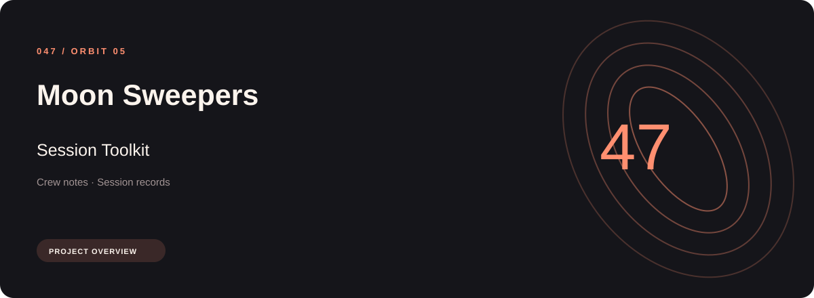
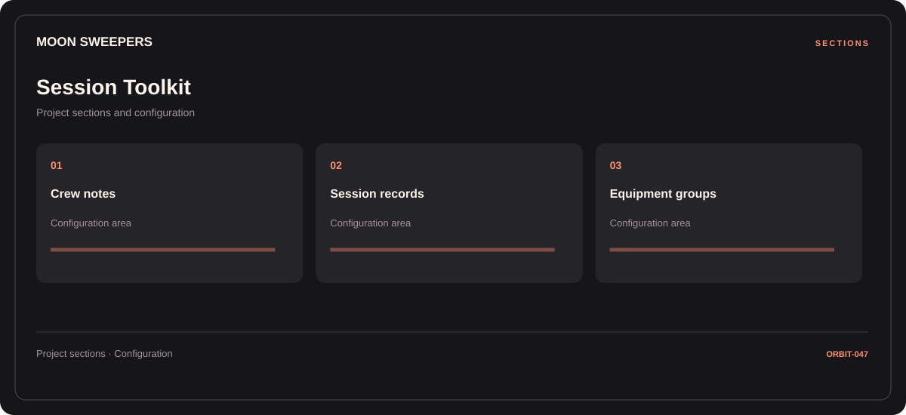

# 🧭 Moon Sweepers Session Toolkit

**Crew notes · Session records · Equipment groups**

## ⚡ Features

The Moon Sweepers session toolkit workflow separates crew notes from session records and equipment groups. Named sections make the available options easier to find.

### ⚙️ Crew notes

Character or team groups presented with the context needed to organize a session.

### 🧩 Session records

Session and activity information grouped by the task or context it belongs to.

### ⌨️ Equipment groups

Equipment categories and the associated selection or configuration options.

## 🖥️ Project navigation

## 📥 Download

The button and cover open the project's download page. Use the information supplied with the downloaded package for installation and release-specific requirements.

## 📚 Project documentation

- [Feature reference](docs/FEATURES.md)
- [Download information](docs/DOWNLOAD.md)
- [Project page](index.html)

---

Moon Sweepers Session Toolkit · Program documentation and download information.
